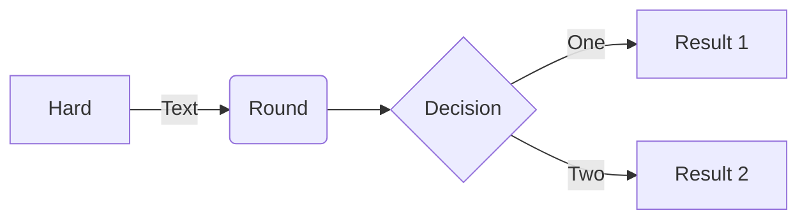

# Hello World!

This is my first blog post. 

## Image

I just created the blog with a wonderfull image:

{: width="300"}
_This is my AI generated avatar picture_

## Video

Have you seen the Tesla Roadster introduction last week? 



## Code 

Another cool thing, you can formatted code:

```shell
echo 'With line numbers!'
echo 'Here is the 2nd line!'
```

## Math

$$ a^2+b^2=c^2 $$ 

## Mermaid



Let's see if all works...
