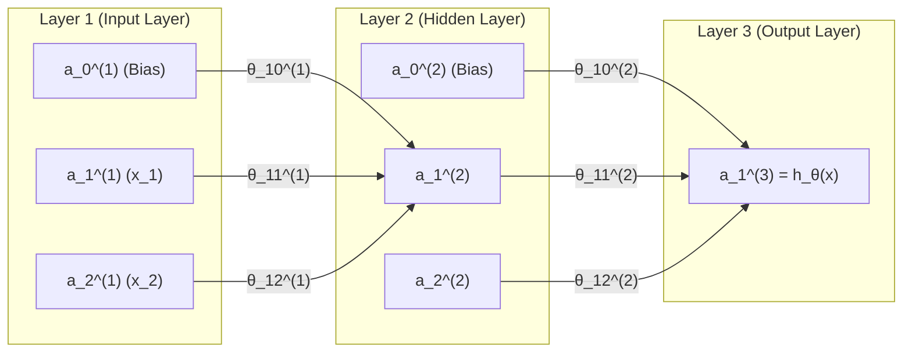

## 1. Introduction

An **Artificial Neural Networks (ANN)** is a computational model inspired by the biological neural networks that make up the human brain. It is a system designed to recognize patterns, process complex data, and learn to make decisions or predictions by mapping inputs to outputs. Unlike traditional programming where you explicitly write rules, a neural network learns from data by adjusting internal parameters (also called weights) through training.

At its core, a neural network is a universal **function approximator**. The general mapping of input $X$ to output $y$ describes the mathematical journey data takes as it enters the network, transforms through layers of learned representations, and emerges as a prediction. Mathematically, we want to find a set of parameters (weights $\theta$ and biases) that defines a hypothesis function $h_\theta(X $ such that:

$$h_\theta(X) \approx y$$


### 1.1. Core Architectural Components

Structurally, a neural network is organized into interconnected layers of nodes (neurons), denoted as $a^{(1)}, a^{(2)}, \dots, a^{(L)}$, where $L$ is the number of layers:

* **Input Layer ($a^{(1)} = x$):** The entry point of the network. It receives the raw feature data (e.g., pixels of an image, numerical measurements). No computation happens here; it simply passes the data forward.
* **Hidden Layers:** The computational engine of the network located between the input and output layers. They extract increasingly abstract features and hierarchical representations from the data. A network can have anywhere from one hidden layer (shallow) to hundreds (deep learning).
* **Output Layer ($a^{(L)} = y$ or $h_\theta(x)$):** The final layer that produces the network's prediction, classification, or regression result.

### 1.2. Units, Weights, and Biases

Each layer $a^(l)$ is composed of individual processing units (neurons) $a^{(l)}_1, \dots, a^{(l)}_{s_l}$.

* **Weights ($\theta$):** Connections between units in adjacent layers have numerical weights attached to them. These weights determine the strength and influence of one neuron's output on another, and they are what the network tunes during training. If layer $l$ has $s_l$ units and layer $l+1$ has $s_{l+1}$ units, the weight matrix $\theta^{(l)}$ controlling their mapping has dimensions **$s_{l+1} \times (s_l + 1)$** (accounting for the bias).
* **Bias Units ($a^{(l)}_0 = 1$):** Added to all layers except the output layer, bias units act like an intercept term in linear regression. They allow the activation function to shift left or right, giving the network the flexibility to fit the data better.


The following diagram illustrates a small network with an input layer, a hidden layer, and an output layer, showing how units connect via weight matrices ($\theta$):




## 2. Forward Propagation

Forward propagation (or the forward pass) is the process by which raw input data is fed into a neural network, passed sequentially through all hidden layers, and transformed into a final prediction ($h_\theta(x)$ or $\hat{y}$).

It is called "forward" because information flows in only one direction—from the input layer, through the hidden layers, to the output layer, without loops. Here is a detailed, step-by-step breakdown of how forward propagation works mathematically and computationally.

Here is the step-by-step breakdown of how the mapping from input data to ourput predictiona occurs under the hood:

### 2.1. The Input Stage ($X$)

The mapping begins with your raw data, represented as a matrix $X$.

* Each row corresponds to a single training example, and each column corresponds to a feature (e.g., pixels, measurements, text embeddings).
* A bias column (usually a column of $1$s) is prepended to $X$ to account for the intercept terms.

### 2.2. The Linear Transformation (Weighted Sum)

Inside any hidden layer, the network first performs a linear operation. It takes the incoming activations from the previous layer, multiplies them by a matrix of learned **weights ($\theta$)**, and adds the bias.

For the first hidden layer, this looks like:


$$z^{(2)} = X (\theta^{(1)})^T$$

* **What it does:** This combines the features linearly. For example, in image recognition, an early layer might combine pixel values to detect simple lines or edges.

### 2.3. The Non-Linear Activation ($g$)

If we only used linear transformations, stacking multiple layers would be pointless (because a linear combination of linear functions is just another linear function).

To fix this, the linear sum $z^{(2)}$ is passed through a **non-linear activation function** $g$ (such as ReLU, Tanh, or Sigmoid):


$$a^{(2)} = g(z^{(2)})$$

* **What it does:** This introduces non-linearity, allowing the network to "bend" and "twist" the feature space. This is the secret sauce that lets neural networks learn complex, curved boundaries rather than just straight lines.

Here is a quick reference of the most commonly used non-linear activation functions:

| Activation Function | Output Range | Primary Use Case | Main Advantage |
| --- | --- | --- | --- |
| **Sigmoid** | $(0, 1)$ | Binary classification output | Smooth probability mapping |
| **ReLU** | $[0, \infty)$ | Default for hidden layers | Fast computation, prevents saturation |
| **Leaky ReLU** | $(-\infty, \infty)$ | Hidden layers (alternative to ReLU) | Prevents "dying ReLU" |
| **Tanh** | $(-1, 1)$ | Hidden layers (recurrent networks) | Zero-centered outputs |
| **Softmax** | $(0, 1)$ [sum to 1] | Multi-class output layer | Valid probability distribution |


### 2.4. Deep Layer Progression

In a deep network, this two-step process—**Linear combination followed by Non-linear activation**—repeats sequentially across multiple hidden layers ($a^{(2)} \rightarrow a^{(3)} \rightarrow \dots \rightarrow a^{(L-1)}$):

* **Early layers** detect low-level features (edges, corners).
* **Middle layers** combine them into parts/shapes (eyes, wheels, textures).
* **Deep layers** combine parts into high-level semantic concepts (faces, cars, complete objects).

### 2.5. The Output Layer (The Prediction $h_\theta(X)$)

Finally, the activations of the last hidden layer are mapped to the **output layer** to produce the hypothesis $h_\theta(X)$:

* For **regression tasks**, it outputs continuous real numbers.
* For **binary classification**, a Sigmoid function squashes the output into a probability between $0$ and $1$.
* For **multi-class classification**, a Softmax function turns raw scores into a probability distribution across all target classes $K$ that sum to $1.0$.

### 2.6. Closing the Loop: Learning the Mapping

At initialization, the weights ($\theta$) are random, so the output $y_{\text{pred}}$ will be completely wrong. The mapping becomes accurate through **training**:

1. **Loss Calculation:** A cost function compares the network's prediction $h_\theta(X)$ against the true ground-truth label $y$.
2. **Backpropagation:** The error is pushed backward through the network to calculate how much each weight contributed to the mistake.
3. **Gradient Descent:** The weights are slightly adjusted to minimize the error.

By repeating this millions of times over a dataset, the network gradually tunes its internal weights so that input $X$ maps reliably and accurately to the correct output $y$.

### 2.7. Step-by-Step Mathematical Flow (Matrix/Vectorized Form)

In modern machine learning, we don't process data one sample at a time; we process a whole batch of $m$ training examples simultaneously using **matrix multiplication**.

Let’s trace a standard network with one input layer, one hidden layer, and one output layer:

#### Step 0: The Input Matrix ($A^{(1)}$)

Let your training dataset be a matrix $X$ of shape $m \times n$ ($m$ examples, $n$ features).

* To account for the bias term, we prepend a column of $1$s to $X$.
* This becomes our first activation layer, $A^{(1)}$, with dimensions $m \times (n + 1)$.

$$A^{(1)} = \begin{bmatrix} 1 & x_1^{(1)} & x_2^{(1)} & \dots & x_n^{(1)} \\ 1 & x_1^{(2)} & x_2^{(2)} & \dots & x_n^{(2)} \\ \vdots & \vdots & \vdots & \ddots & \vdots \\ 1 & x_1^{(m)} & x_2^{(m)} & \dots & x_n^{(m)} \end{bmatrix}$$

#### Step 1: Computing the Hidden Layer ($A^{(2)}$)

To move from the input layer to the hidden layer, we multiply the activation matrix $A^{(1)}$ by the transpose of the first weight matrix $\theta^{(1)}$:

$$Z^{(2)} = A^{(1)} (\theta^{(1)})^T$$

* **Dimension Check:** If $A^{(1)}$ is $m \times (s_1 + 1)$ and $\theta^{(1)}$ has dimensions $s_2 \times (s_1 + 1)$, then transposed weight matrix $(\theta^{(1)})^T$ has dimensions $(s_1 + 1) \times s_2$. The resulting $Z^{(2)}$ matrix has dimensions **$m \times s_2$** (one row per training example, one column per hidden unit).

Next, we apply the non-linear activation function $g$ (like Sigmoid or ReLU) element-wise to get the hidden layer activations:

$$A^{(2)} = g(Z^{(2)})$$

To prepare $A^{(2)}$ for the next layer, we **add a bias column** (a column of $1$s) to the left side of $A^{(2)}$. Its dimensions now become $m \times (s_2 + 1)$.

#### Step 2: Computing the Output Layer ($A^{(3)}$ or $\hat{Y}$)

Next, we propagate the hidden layer activations to the output layer using the second weight matrix $\theta^{(2)}$:

$$Z^{(3)} = A^{(2)} (\theta^{(2)})^T$$

Finally, we apply the output activation function (Sigmoid for binary classification, Softmax for multi-class, or linear for regression) to produce the final hypothesis/prediction:

$$A^{(3)} = g(Z^{(3)})$$

The resulting matrix $A^{(3)}$ contains the final predictions of the model for all $m$ training examples.


#### Why Vectorization Matters

If you looped through all $m$ training examples one by one using standard `for` loops, training would take an excruciatingly long time. By structuring forward propagation as **matrix multiplication**, libraries like NumPy, PyTorch, and TensorFlow can offload these massive dot products onto Graphical Processing Units (GPUs). GPUs excel at parallelizing matrix operations, allowing a neural network to compute forward passes for thousands of high-dimensional images or data points in milliseconds.


#### Summary of Forward Propagation Shapes

To keep track of what's happening, dimensions flow like this during a forward pass:

* **Input ($X$):** $(m \times n)$ $\rightarrow$ with bias: $(m \times (n+1))$
* **Hidden Weights ($\theta^{(1)}$):** $(s_2 \times (n+1))$
* **Hidden Activations ($A^{(2)}$):** $(m \times s_2)$ $\rightarrow$ with bias: $(m \times (s_2+1))$
* **Output Weights ($\theta^{(2)}$):** $(K \times (s_2+1))$
* **Final Predictions ($A^{(3)}$):** $(m \times K)$ *(where $K$ is the number of output classes/units)*

### 2.8. Example

Here is a classic computer vision example of recognizing handwritten digits from **$16 \times 16$ pixel black-and-white images** (predicting digits 0 through 9).

#### Forward Propagation Example: Dimensions and Shapes (Digit Recognition)

Let's trace how matrix dimensions flow through the network using a dataset of $m = 5000$ images:

* **Input Features ($X$):** Each image is $16 \times 16$ pixels. Flattening each image grid into a single row vector yields $16 \times 16 = 256$ input features. For $5000$ training examples, the raw input matrix $X$ has dimensions **$5000 \times 256$**.
* **Layer 1 (Input Layer / $A^{(1)}$):** Prepending a column of bias units ($x_0 = 1$) to account for the intercept term turns the input matrix into **$5000 \times 257$** ($256$ features + $1$ bias).
* **Layer 2 (Hidden Layer / $A^{(2)}$):** Let's design the hidden layer to contain $25$ neurons.
* The first weight matrix $\theta^{(1)}$ maps the $257$ input columns to the $25$ hidden units, giving it dimensions of **$25 \times 257$**.
* The linear transformation $Z^{(2)} = X (\theta^{(1)})^T$ yields a matrix of shape **$5000 \times 25$**.
* After applying the sigmoid activation function $g$ and appending a bias column ($a^{(2)}_0 = 1$), the hidden activation matrix $A^{(2)}$ becomes **$5000 \times 26$**.


* **Layer 3 (Output Layer / $A^{(3)}$):** Since we want to classify digits into 10 categories ($0$ through $9$), we use $10$ output units.
* The second weight matrix $\theta^{(2)}$ maps the $26$ hidden activation columns (including its bias) to the $10$ output classes, resulting in dimensions of **$10 \times 26$**.
* The final output prediction matrix $A^{(3)} = g(A^{(2)} (\theta^{(2)})^T)$ yields a shape of **$5000 \times 10$**, where each row contains the probability distribution across all 10 digits for each respective image.


#### Python (NumPy) Implementation

```python
import numpy as np

def sigmoid(z):
    """Computes the element-wise sigmoid activation function."""
    return 1 / (1 + np.exp(-z))

def predict(Theta1, Theta2, X):
    """
    Predicts the digit class (0-9) for 16x16 pixel 
    grayscale images using a trained neural network.
    
    Parameters:
    - Theta1: Weights for the hidden layer (shape: 25 x 257)
    - Theta2: Weights for the output layer (shape: 10 x 26)
    - X: Input image data matrix, flattened (shape: 5000 x 256)
    
    Returns:
    - p: Predicted labels vector (shape: 5000 x 1, values 0-9)
    """
    m = X.shape[0]
    
    # 1. Add bias unit x_0 = 1 to the input layer 
    # X shape changes from (5000, 256) to (5000, 257)
    A1 = np.hstack([np.ones((m, 1)), X])
    
    # 2. Compute hidden layer activations 
    # Dot product: (5000 x 257) @ (257 x 25) -> (5000 x 25)
    Z2 = np.dot(A1, Theta1.T)
    A2 = sigmoid(Z2)
    
    # 3. Add bias unit to hidden layer activations 
    # A2 shape changes from (5000, 25) to (5000, 26)
    A2 = np.hstack([np.ones((m, 1)), A2])
    
    # 4. Compute output layer hypothesis (probabilities for each digit class)
    # Dot product: (5000 x 26) @ (26 x 10) -> (5000 x 10)
    Z3 = np.dot(A2, Theta2.T)
    A3 = sigmoid(Z3)
    
    # 5. Predict the class with the highest probability (0-indexed: 0-9)
    # argmax along axis=1 naturally yields standard 0-indexed python arrays (0 to 9)
    p = np.argmax(A3, axis=1)
    
    return p.reshape(-1, 1)  # Return as a column vector of shape (5000 x 1)
```


## 3. Loss Function vs. Cost Function

The choice of a cost and loss function depends entirely on the **type of machine learning task** you are solving.

* **Loss Function ($L(y, h_\theta(x))$):** Measures the error for a **single** training example.
* **Cost Function ($J(\theta)$):** The average of the loss functions across **all** $m$ training examples in the dataset:

$$J(\theta) = \frac{1}{m} \sum_{t=1}^m L(y^{(t)}, h_\theta(x^{(t)}))$$

Here are the most commonly used cost functions in modern deep learning, categorized by their use cases:


### 3.1. Regression Cost Functions (Predicting Continuous Values)

When your output is a continuous numerical value (e.g., predicting house prices, temperature, or stock values), these are the standard choices:

#### Mean Squared Error (MSE / L2 Loss)

* **Formula:** $J(\theta) = \frac{1}{m} \sum_{t=1}^m (y^{(t)} - \hat{y}^{(t)})^2$
* **How it works:** It calculates the average of the squared differences between the predicted values ($\hat{y}$) and the actual target values ($y$).
* **Characteristics:** Because it squares the errors, large mistakes are penalized exponentially more than small ones. This makes the model focus heavily on reducing large outliers.
* **Primary Use Case:** Default choice for standard regression tasks.

#### Mean Absolute Error (MAE / L1 Loss)

* **Formula:** $J(\theta) = \frac{1}{m} \sum_{t=1}^m \vert{}y^{(t)} - \hat{y}^{(t)}\vert{}$
* **How it works:** It measures the average magnitude of absolute errors without considering their direction.
* **Characteristics:** Unlike MSE, MAE treats all errors equally. This makes it **robust to outliers** (extreme data points won't completely skew the training process).
* **Primary Use Case:** Regression tasks where data contains significant noise or extreme outliers.

#### Huber Loss

* **How it works:** It acts as a hybrid between MSE and MAE. It behaves like MSE when the error is small (allowing for smooth optimization near the minimum) and like MAE when the error is large (limiting the impact of outliers).
* **Primary Use Case:** Regression problems that need robustness against outliers without sacrificing smooth gradients.


### 3.2. Classification Cost Functions (Predicting Categories)

When your output involves assigning data to discrete classes or categories, cross-entropy-based losses are the industry standard:

#### Binary Cross-Entropy (BCE)

* **Formula:** $J(\theta) = -\frac{1}{m} \sum_{t=1}^m \left[ y^{(t)} \log(\hat{y}^{(t)}) + (1 - y^{(t)}) \log(1 - \hat{y}^{(t)}) \right]$
* **How it works:** Compares the predicted probability (output of a Sigmoid function, ranging from $0$ to $1$) against the true binary label ($0$ or $1$).
* **Primary Use Case:** Binary classification tasks (e.g., spam vs. not spam, cat vs. dog).

#### Categorical Cross-Entropy

* **Formula:** $J(\theta) = -\frac{1}{m} \sum_{t=1}^m \sum_{k=1}^K y^{(t)}_k \log(\hat{y}^{(t)}_k)$
* **How it works:** Used alongside a **Softmax** activation function in the output layer. It evaluates multi-class probability distributions where the true labels are **one-hot encoded** (e.g., target class 2 out of 4 is represented as $[0, 1, 0, 0]$).
* **Primary Use Case:** Multi-class classification where an instance belongs to exactly one of $K$ mutually exclusive classes.

#### Sparse Categorical Cross-Entropy

* **How it works:** Mathematically identical to Categorical Cross-Entropy, but with one crucial engineering difference: **it accepts integer-encoded target labels** (e.g., $y = 2$) instead of requiring one-hot vector arrays (e.g., $y = [0, 0, 1, 0]$).
* **Primary Use Case:** Multi-class classification datasets with a large number of classes (like ImageNet with 1,000 classes), as it saves significant memory by avoiding one-hot conversion.


### 3.3. Quick Reference Summary Table

| Task Type | Cost / Loss Function | Output Activation | Typical Application |
| --- | --- | --- | --- |
| **Regression** | Mean Squared Error (MSE) | None (Linear) | House prices, temperature prediction |
| **Regression** | Mean Absolute Error (MAE) | None (Linear) | Robust forecasting with outliers |
| **Binary Classification** | Binary Cross-Entropy | Sigmoid | Yes/No, Spam detection |
| **Multi-class Classification** | Categorical Cross-Entropy | Softmax | One-hot labels (e.g., handwritten digits 0–9) |
| **Multi-class Classification** | Sparse Categorical Cross-Entropy | Softmax | Integer labels (memory efficient for many classes) |


To ensure complete consistency with **Section 1** (and Section 2), the notation for the weight matrices has been harmonized from uppercase ($\Theta$) to lowercase ($\theta$) to match how weights are defined originally ($\theta$, $\theta^{(l)}$), and all references to dimensions, bias units, and indices have been aligned.


## 4. Backpropagation

Backpropagation (short for "backward propagation of errors") is the foundational algorithm that allows neural networks to learn. While forward propagation makes a prediction, backpropagation figures out *why* the prediction was wrong and assigns blame to every single weight in the network. It computes the partial derivative of the cost function with respect to every weight in the network ($\frac{\partial J}{\partial \theta}$), telling us exactly how much we need to tweak each weight to reduce the overall error.

### 4.1. The Step-by-Step Mechanics of Backpropagation

Backpropagation always flows in reverse—starting from the output layer and working backward to the input layer. For a batch of $m$ training examples, the process works as follows:

#### Step 1: The Forward Pass (Preparation)

Before you can backpropagate, you must run a complete **forward pass**. You feed the input $X$ through the network, compute all intermediate activations ($A^{(1)}, A^{(2)}, \dots$), and store them. You need these activation values during the backward pass.

#### Step 2: Compute the Output Layer Error ($\delta^{(L)}$)

At the final output layer ($L$), the error vector ($\delta^{(L)}$) is fundamentally derived from the cost/loss function as the partial derivative with respect to the output layer's pre-activation ($Z^{(L)}$):

$$\delta^{(L)} = \frac{\partial J}{\partial Z^{(L)}} = A^{(L)} - Y$$

*(Note: For standard architectures—such as Mean Squared Error with a linear output, or Cross-Entropy paired with Sigmoid/Softmax activations—the calculus simplifies cleanly so that the error is simply the difference between the network's prediction $A^{(L)}$ and the true ground-truth label $Y$. For example, if your network predicts a $70\%$ probability for a class, but the true label is $1$, the error is $0.7 - 1.0 = -0.3$).*

#### Step 3: Propagate Error Backward into Hidden Layers ($\delta^{(l)}$)

To find the error for a hidden layer, you take the error from the layer ahead of it, multiply it by the weight matrix connecting them, and scale it by the derivative of the activation function:

$$\delta^{(l)} = (\delta^{(l+1)} \cdot \theta^{(l)}_{\text{no bias}}) \odot g'(Z^{(l)})$$

* **The Weight Matrix:** We use $\theta^{(l)}$ transposed or multiplied directly, but **crucially, we exclude the bias row/column** because bias units do not receive error signals from previous layers.
* **Element-wise Multiplication ($\odot$):** We multiply by the derivative of the activation function ($g'$), which for a sigmoid function evaluates compactly to $A^{(l)} \odot (1 - A^{(l)})$. This measures how sensitive the hidden neurons were to changes.

#### Step 4: Compute the Gradients ($\Delta$ or $\text{Grad}$)

Once you have the error vectors ($\delta$) for all layers, you calculate the partial derivatives (gradients) for each weight matrix by multiplying the layer's error by the previous layer's activations:

$$\frac{\partial J}{\partial \theta^{(l)}} = \frac{1}{m} (\delta^{(l+1)})^T A^{(l)}$$

#### Step 5: Gradient Descent Weight Update

Finally, you update your weights by taking a small step (defined by the learning rate $\alpha$) in the opposite direction of the gradient:

$$\theta^{(l)} := \theta^{(l)} - \alpha \left(\frac{\partial J}{\partial \theta^{(l)}}\right)$$

### 4.2. Python (NumPy) Example

Here is a vectorized Python function that performs a single backpropagation step to compute the gradients for our $16 \times 16$ pixel digit recognition network (matching the dimensions and variable naming conventions from Section 2):

```python
import numpy as np

def sigmoid(z):
    """Computes the element-wise sigmoid activation function."""
    return 1 / (1 + np.exp(-z))

def compute_cost_and_gradients(Theta1, Theta2, X, y_one_hot):
    """
    Computes the neural network cost and gradients using backpropagation.
    
    Parameters:
    - Theta1: Hidden layer weights (shape: 25 x 257)
    - Theta2: Output layer weights (shape: 10 x 26)
    - X: Input image data matrix, flattened (shape: 5000 x 256)
    - y_one_hot: One-hot encoded true labels (shape: 5000 x 10)
    
    Returns:
    - Theta1_grad: Gradient for Theta1 (shape: 25 x 257)
    - Theta2_grad: Gradient for Theta2 (shape: 10 x 26)
    """
    m = X.shape[0]
    
    # ==========================================
    # 1. FORWARD PASS
    # ==========================================
    # Add bias column to input -> (5000 x 257)
    A1 = np.hstack([np.ones((m, 1)), X])
    
    # Hidden layer -> (5000 x 25)
    Z2 = np.dot(A1, Theta1.T)
    A2 = sigmoid(Z2)
    
    # Add bias column to hidden layer -> (5000 x 26)
    A2_bias = np.hstack([np.ones((m, 1)), A2])
    
    # Output layer -> (5000 x 10)
    Z3 = np.dot(A2_bias, Theta2.T)
    A3 = sigmoid(Z3)  # This is our hypothesis h_theta(x)
    
    # ==========================================
    # 2. BACKPROPAGATION PASS
    # ==========================================
    # Output layer error (delta 3) -> (5000 x 10)
    delta3 = A3 - y_one_hot
    
    # Hidden layer error (delta 2) 
    # Note: We drop the bias column of Theta2 (Theta2[:, 1:]) because bias has no incoming error.
    # Dot product: (5000 x 10) @ (10 x 25) -> (5000 x 25)
    delta2 = np.dot(delta3, Theta2[:, 1:]) * A2 * (1 - A2)
    
    # ==========================================
    # 3. ACCUMULATE GRADIENTS
    # ==========================================
    # Theta2 gradient: (10 x 5000) @ (5000 x 26) -> (10 x 26)
    Theta2_grad = np.dot(delta3.T, A2_bias) / m
    
    # Theta1 gradient: (25 x 5000) @ (5000 x 257) -> (25 x 257)
    Theta1_grad = np.dot(delta2.T, A1) / m
    
    return Theta1_grad, Theta2_grad

```

Here is a concise and impactful **Conclusion** chapter to wrap up your article, bringing together all the foundational concepts you've covered:

---

## 5. Conclusion

Artificial Neural Networks form the backbone of modern machine learning and deep learning. By bridging raw data and complex decision-making through mathematical foundations, they act as powerful, adaptive function approximators.

To recap, the learning lifecycle of a neural network relies on a continuous, cyclical loop of three core pillars:

* **Forward Propagation:** Transforms raw inputs ($X$) sequentially through weighted linear combinations and non-linear activation functions to generate a prediction ($h_\theta(x)$).
* **Cost Evaluation:** Quantifies the model's mistakes by comparing predictions against ground-truth labels using specialized loss functions (such as MSE or Cross-Entropy).
* **Backpropagation & Optimization:** Propagates the error backward through the network to compute gradients ($\frac{\partial J}{\partial \theta}$), allowing gradient descent to fine-tune weights and minimize overall error.

Mastering these core mechanics—from matrix dimensions and activation functions to gradient computation—provides the essential bedrock required to understand and build advanced architectures, ranging from Convolutional Neural Networks (CNNs) for computer vision to Large Language Models (LLMs) for natural language processing.


## 6. References

1. **Andrew Ng (Stanford University / Coursera)**
*Machine Learning Course Notes: Neural Networks Representation & Learning*
[Julian Yulu's Machine Learning Notes (GitHub)](https://github.com/julianyulu/Machine-Learning-Notes)
2. **DeepLearning.AI & Stanford Online**
*Machine Learning Specialization*
[Coursera Specialization Page](https://www.coursera.org/specializations/machine-learning-introduction) | [Stanford Online Portal](https://online.stanford.edu/courses/soe-ymls-machine-learning-specialization)
3. **Tung Hiem (2022)**
*A Simple Exposition on Andrew Ng's Backpropagation Formulas*
[Medium Article](https://medium.com/@tunghiem2010/a-simple-exposition-on-andrew-ngs-backpropagation-formulas-e60367a848da)
4. **Ashish Patel**
*Andrew Ng Machine Learning & Deep Learning Course Notes Collection*
[GitHub Repository](https://github.com/ashishpatel26/Andrew-NG-Notes)
