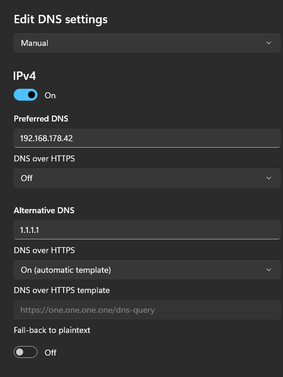

Pi-hole ist ein Werbe- und Tracker-Blocker und arbeitet als ein sogenannter DNS-Server (Domain Name System) im Heimnetzwerk:
1. Wenn du eine Website aufrufst, fragt dein Gerät nach der IP-Adresse dieser Seite.
2. Pi-hole fängt diese Anfrage ab und gleicht sie mit einer Blockliste ab. 
3. Gehört die Domain zu einem Werbebanner oder Tracker, liefert Pi-hole eine "falsche" Antwort zurück (sie wird ins Leere geleitet). Die Werbung wird gar nicht erst geladen.

Vorteil Seiten laden schneller, Datenvolumen wird gespart und "smarte" Geräte (wie Fernseher) können dich nicht mehr so leicht ausspionieren.

## Installation auf einem Raspberry Pi (z.B. Zero2W)

1. Installiere mit dem Raspberry Pi OS Lite auf einer microSD-Karte.
2. Konfiguriere den SSH-Zugriff und verbinde dich it dem Pi
3. Aktualisiere zuerst das System:
```bash
sudo apt update && sudo apt upgrade -y
```

4. Pi-hole lässt sich über einen einzigen, automatischen Befehl installieren:
```bash
curl -sSL https://install.pi-hole.net | bash
```

5. Bestätige die Abfragen (Netzwerkschnittstelle, Protokolle) mit Enter.
6. Wähle einen öffentlichen DNS-Anbieter (z. B. Cloudflare oder Quad9), an den Pi-hole Anfragen weiterleitet.
7. Am Ende zeigt dir das Skript eine IPv4-Adresse und ein Admin-Passwort für die Weboberfläche an. Notiere dir beide!
8. Gib im Browser `http://<IP-Adresse-deines-Pi-Hole>/admin` ein und logge dich mit dem bei der Installation generierten Passwort ein.

Hier findes du eine [ausführliche Anleitung zur Installation](https://docs.pi-hole.net/main/basic-install/){:target="_blank"}

## Pi-hole als DNS-Server für das ganze Netzwerk einrichten

### Wichtige Schritte bei der Fritzbox-Konfiguration

* Feste IP-Adresse: Weise dem Gerät, auf dem Pi-hole läuft, in der Fritzbox eine feste IPv4-Adresse zu (unter Heimnetz -> Netzwerk -> Gerätewerte bearbeiten) – am besten außerhalb des automatischen DHCP-Bereichs, damit sich die IP nicht ändert.
* Lokalen DNS-Server für das Heimnetz einstellen: 
  ** Gehe zu Heimnetz -> Netzwerk -> Netzwerkeinstellungen -> Erweiterte Netzwerkeinstellungen -> IPv4 und trage dort die IPv4-Adresse des Pi-holes als **Lokaler DNS-Server** ein
  ** Gehe zu IPv6. Aktiviere "DNSv6-Server auch über Router Advertisement bekanntgeben (RFC 5006)" und die IPv6-Adresse des Pi-holes unter **Lokaler DNSv6-Server** ein
* Conditional Forwarding: Aktiviere im Pi-hole Web UI unter Settings -> DNS -> Conditional Forwarding die Option, damit das Pi-hole Anfragen für lokale Namen (fritz.box) an die Fritzbox-IP (meist 192.168.178.1) zurückspielt. So siehst du in den Pi-hole-Logs wieder die echten Gerätenamen statt nur die IP-Adresse. Allerdings: Conditional Forwarding im Pi-hole ist standardmäßig rein auf IPv4 ausgelegt.
Wenn ein Gerät eine DNS-Anfrage über seine IPv6-Adresse an das Pi-hole schickt, versucht das Pi-hole via IPv4-Namensauflösung vergeblich, dieser IPv6-Adresse einen Namen zuzuordnen.
  ** Local Network: Dein IP-Bereich im Format mit CIDR-Notation (meistens ist das 192.168.178.0/24).
  ** IP of your router: Die IP-Adresse deiner Fritzbox (Standard: 192.168.178.1)
  ** Local domain name (optional): Das Standard-Suffix der Fritzbox (fritz.box)
* IPv6 beachten: Wenn IPv6 aktiv ist, solltest du den ULA-Adressraum in der Fritzbox aktivieren und die lokale IPv6-Adresse des Pi-holes ebenfalls als DNSv6-Server verteilen, da Geräte sonst über IPv6 am Pi-hole vorbeisurfen.
* Manche Geräte (wie Google Chromecast oder Smart-TVs) haben einen DNS-Server fest eincodiert. Über die Fritzbox-Filter kannst du in den Zugangsprofilen festlegen, dass Port 53 und 853 (DNS / DNS-over-TLS) für alle Geräte außer dem Pi-hole gesperrt werden.


#### Wie überprüfe ich, dass es richtig funktioniert?

Du kannst die Funktion auf zwei Wegen überprüfen – direkt im Dashboard oder über die Kommandozeile.

* Methode A: Das Pi-hole Dashboard 
  1. Gehe im Pi-hole auf Query Log.
  2. Schaue in die Spalte Client.
  3. Ergebnis: Nach wenigen Minuten sollten dort statt reiner IP-Adressen die Klarnamen deiner Geräte auftauchen (z. B. iPhone-von-Alex.fritz.box statt 192.168.178.34). 
* Methode B. Terminal
Öffne die Eingabeaufforderung (Windows) oder das Terminal (Mac/Linux) auf einem Computer im Netzwerk und frage das Pi-hole gezielt nach dem Namen einer bekannten lokalen IP ab (Reverse DNS Lookup):

```bash
nslookup 192.168.178.XX
```

Ersetze 192.168.178.XX mit der IP-Adresse eines aktiven Geräts in deinem Netzwerk, z. B. deinem Smartphone.
* Erfolgreiches Ergebnis: Das Terminal spuckt dir den Namen des Geräts aus
* Fehlerhaftes Ergebnis: Wenn dort NXDOMAIN oder Non-existent domain steht, blockiert die Fritzbox die Anfrage

Hier findest du eine [ausführliche Anleitung zur Konfiguration](https://www.kuketz-blog.de/pi-hole-einrichtung-und-konfiguration-mit-fritzbox-adblocker-teil1/){:target="_blank"}

## Pi-hole als DNS-Server unter Windows 11 für einzelne Geräte einrichten

Hinweis: Dieses Vorgehen bindet Pi Hole nur auf dem jeweiligen Windows Recher ein. Alternativ kann Pi Hole auch im Router (z.B. Fritzbox) für alle Geräte im Netzwerk eingerichtet werden, 

1. Öffnen Sie die Einstellungen (Tastenkombination Windows-Taste + i).
2. Navigieren Sie links zu **Netzwerk und Internet** und klicken Sie rechts auf Ihre aktive Verbindung (WLAN oder Ethernet).
3. Scrollen Sie nach unten zum Punkt **DNS-Serverzuweisung** und klicken Sie auf Bearbeiten.
4. Stellen Sie das Dropdown-Menü ganz oben auf **Manuell** und aktivieren Sie den Schalter bei **IPv4**.
5. Bevorzugter DNS: Tragen Sie hier die IP-Adresse ihres lokales Pi-hole ein. Belassen Sie die Option Bevorzugte DNS-Verschlüsselung auf Nur unverschlüsselt, da das Pi-hole lokal unverschlüsselt abgefragt wird.
6. Alternativer DNS: Tragen Sie hier die IP-Adresse des gewünschten sicheren Anbieters ein (z. B. 1.1.1.1 für Cloudflare).
7. Alternative DNS-Verschlüsselung aktivieren: Sobald Sie eine bekannte IP-Adresse eingegeben haben, schaltet Windows das darunterliegende Feld frei. Wählen Sie dort Nur verschlüsselt (DNS over HTTPS).
8. Deaktivieren sie IPv6
8. Klicken Sie auf Speichern.

{: width="300"}

Mit folgendem Befehl können die IPv4 und IPv6 DNS-Server Adressen direkt gesetzt und überprüft werden (Admin Rechte erforderlich!):
```powershell
Set-DnsClientServerAddress -InterfaceAlias "Ethernet 2" -ServerAddresses ("192.168.xxx.xxx", "fd13:...")
Get-DnsClientServerAddress -InterfaceAlias "Ethernet 2"
```

Über SSH die Pi-hole IPv6 Adresse abfragen:
```bash
ip address | grep "inet6 fd"
```


### Häufiges Problem: 

Obwohl IPv6 in den manuellen  DNS-Einstellungen deaktiviert wurde, holt sich Windows die IPv6-DNS-Adresse automatisch (per DHCPv6 oder Router Advertisement) von Ihrem Router (z.B. Fritzbox). Windows versucht nun stur, diesen zu nutzen. Bei obiger Einstellung wird der IPv6-DNS-Server jedoch blockiert und jede DNS-Anfrage erzeugt einen einen Timeout.

### Einfache Lösung: IPv6 für diese Netzwerkkarte deaktivieren.

Es kann ohne Probleme das IPv6-Protokoll für Ihre aktive Netzwerkkarte komplett abgeschaltet werden:
1. Drücken Sie Windows-Taste + R, tippen Sie `ncpa.cpl` ein und drücken Sie Enter (um die klassischen Netzwerkverbindungen zu öffnen).
2. Machen Sie einen Rechtsklick auf Ihre aktive Verbindung (WLAN oder Ethernet) und wählen Sie Eigenschaften.
3. Suchen Sie in der Liste den Eintrag Internetprotokoll, Version 6 (TCP/IPv6).
4. Entfernen Sie das Häkchen bei diesem Eintrag.
5. Klicken Sie auf OK.

Durch das Entfernen des Häkchens zwingen Sie Windows dazu, jeglichen DNS-Verkehr ausschließlich über das IPv4-Protokoll abzuwickeln. Windows wird ab sofort direkt und ohne Umwege Ihr Pi-hole (und im Notfall den verschlüsselten alternativen DNS) anfragen. Keine Sorge: Sie können im Browser weiterhin ganz normal IPv6-Webseiten aufrufen, da die Namensauflösung nun sauber über IPv4 läuft.

Test: 
* `nslookup google.com` sollte nach dieser Änderung jetzt die IPv4-Adressen angezeigen.
* `nslookup doubleclick.net`sollte 0.0.0.0 liefern

