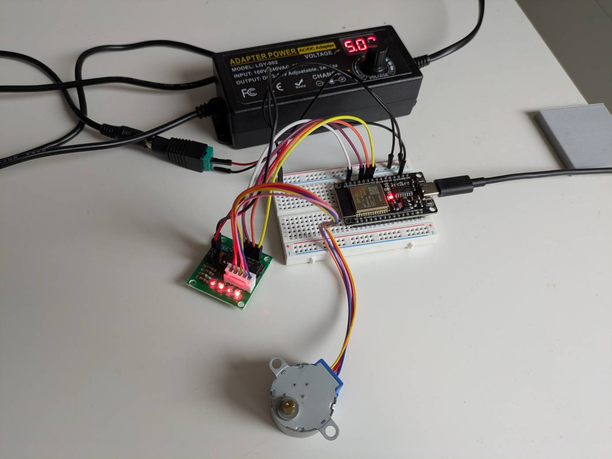
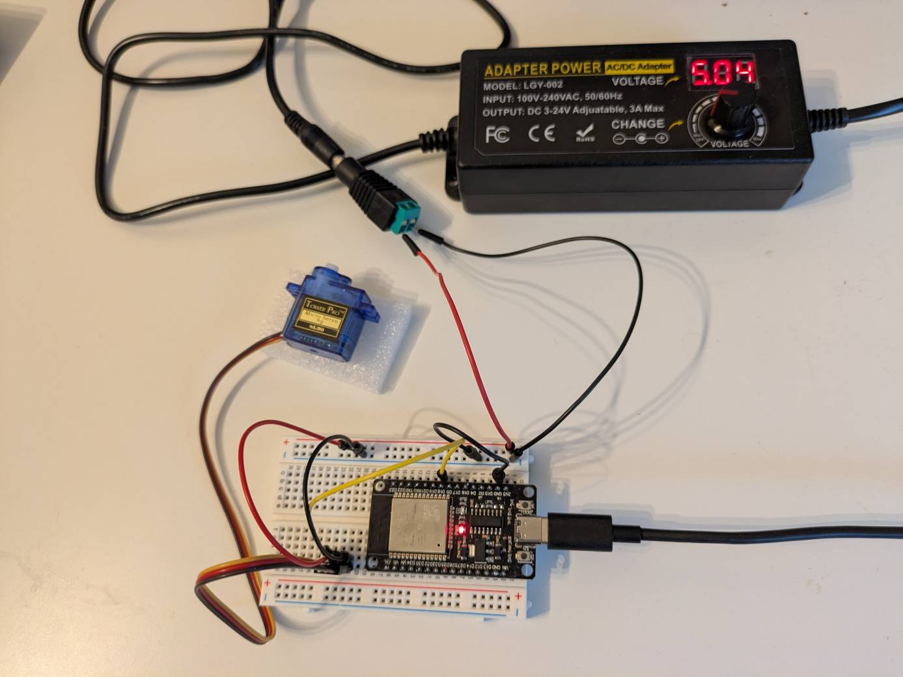
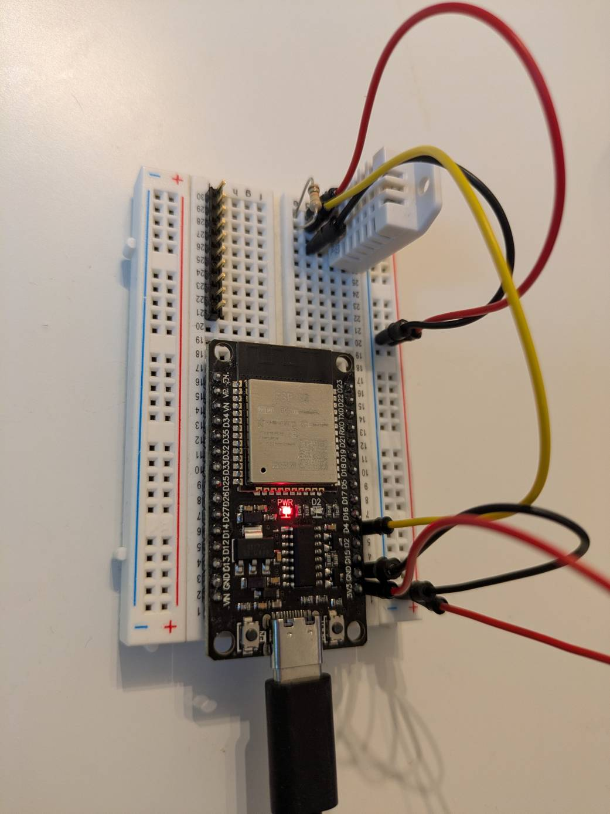
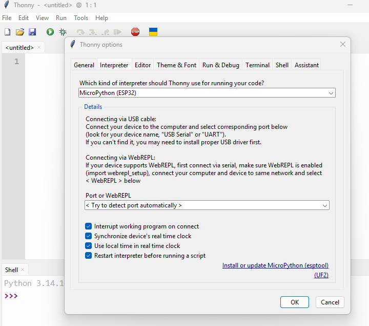
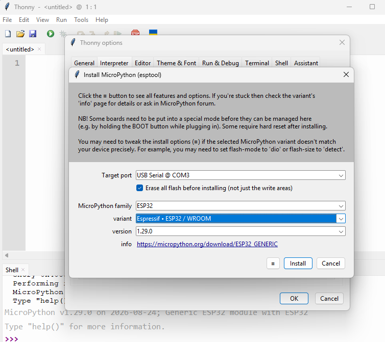
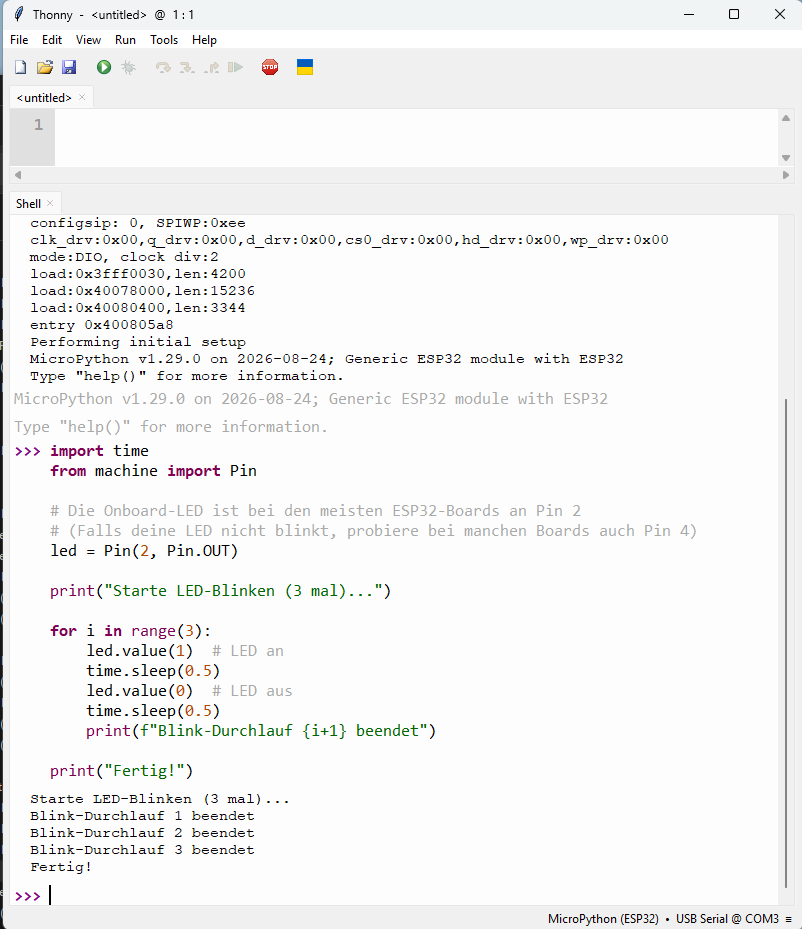
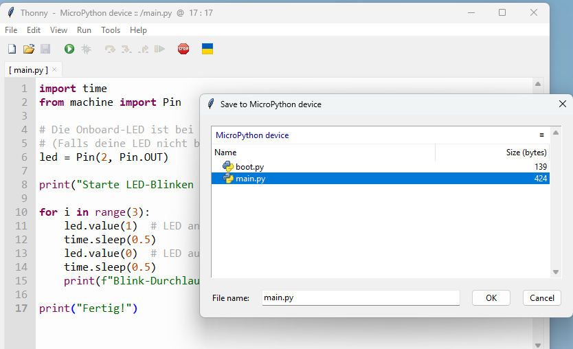

## Code auf den ESP32 laden

Nachfolgend wird das Programmieren des ESP32 in der Programmierspache *C* gezeigt. Das Aufspielen (Flashen) von Code auf einen ESP32 erfolgt am einfachsten über die kostenlose **Arduino IDE**.

1. Lade die aktuelle **Arduino IDE** von der offiziellen Arduino-Website herunter und installiere sie.
2. Öffne die IDE und gehe auf **Datei > Voreinstellungen**.
3. Trage in das Feld *ZusätzlicheBoardManager-URLs* folgende URL ein:
[https://raw.githubusercontent.com/espressif/arduino-esp32/gh-pages/package_esp32_index.json](https://raw.githubusercontent.com/espressif/arduino-esp32/gh-pages/package_esp32_index.json)
4. Gehe auf **Werkzeuge > Board > BoardManager**, suche nach **esp32** (von *Espressif Systems*) und klicke auf **Installieren**.
*Verification:* Nach der Installation findest du im Menü *Werkzeuge > Board* den neuen Unterpunkt „ESP32 Arduino“ mit diversen ESP32-Modellen. 

2. **ESP32 per USB mit dem PC verbinden:** Hardware-Verbindung.
Verbinde deinen ESP32 über ein geeignetes **USB-Datenkabel** (wichtig: manche Kabel übertragen nur Strom, keine Daten!) mit einem freien USB-Anschluss deines Computers.
*Verification:* Die Betriebs-LED auf dem ESP32 leuchtet auf.

3. **Richtigen Port und Board-Typ auswählen:** Konfiguration.
1. Gehe auf **Werkzeuge > Board > ESP32 Arduino** und wähle dein exaktes Modell aus (für die Standard-Entwicklungsboards meist *ESP32 Dev Module*).
2. Gehe auf **Werkzeuge > Port** und wähle den COM-Anschluss aus, an dem dein ESP32 angeschlossen ist (unter Windows z. B. `COM3`).
*Verification:* Rechts unten in der Statusleiste der Arduino IDE werden nun der Name des Boards und der korrekte Port angezeigt.


4. **Test-Code kompilieren und hochladen:** Upload.
1. Füge einen einfachen Test-Code ein (z. B. `Blink`-Beispiel unter *Datei > Beispiele > 01.Basics > Blink*). Passe ggf. den LED-Pin an (beim ESP32 ist das oft Pin `2` oder `GPIO2`).
2. Klicke oben links auf den **Pfeil nach rechts** („Hochladen“).
3. *Hinweis:* Bei einigen ESP32-Boards musst du während des Uploads („Connecting...“) die physische **BOOT-Taste** auf dem Board gedrückt halten, bis der Upload startet und danach die **Reset** Taste.
*Verification:* Die untere Konsole zeigt nach kurzer Zeit „Hard resetting via RTS pin...“ und die Meldung *Done uploading.*. Der Code läuft nun auf dem Mikrocontroller.


## Einen 28BYJ-48 Schrittmotor ansteuern



Um den 5V-Schrittmotor 28BYJ-48 über das ULN2003-Treiberboard an einen ESP32 anzuschließen, benötigst du vier digitale Steuerpins und eine stabile 5V-Stromversorgung.

### Verkabelung

1. **Motor mit Treiberboard verbinden:** Steckverbindung.
Stecke den weißen Stecker des 28BYJ-48 Motors direkt in die passende weiße Buchse auf dem ULN2003-Treiberboard. Er ist so kodiert, dass er nur in einer Richtung hineinpasst.
*Verifikation:* Der Stecker sitzt fest und rastet hörbar oder spürbar ein.

2. **Steuerpins mit dem ESP32 verbinden:** Logik-Signale.
Verbinde die Eingänge des Treiberboards mit vier digitalen GPIOs des ESP32:

* `IN1` $\rightarrow$ GPIO 18
* `IN2` $\rightarrow$ GPIO 19
* `IN3` $\rightarrow$ GPIO 21
* `IN4` $\rightarrow$ GPIO 22
*Verifikation:* Die Jumper-Kabel haben festen Kontakt an den Pins von ESP32 und Treiber.

3. **Stromversorgung anschließen:** 5V und GND.
Verbinde den `VCC`-Pin des Treiberboards mit dem + Pol des 5V-Netzteils sowie `GND` mit dem GND des ESP32 und mit dem - Pol des 5V-Netzteils.
*Verifikation:* Nach dem Einschalten leuchtet die rote Betriebs-LED (`ON`) auf dem ULN2003-Board.


### Beispielcode

Der 28BYJ-48 besitzt ein internes Getriebe mit einer Untersetzung von ca. 63,7:1. Für eine komplette Umdrehung der äußeren Achse benötigt man daher **2038 Schritte**.

```cpp
#include <Stepper.h>

// 2038 Schritte pro Umdrehung: Untersetzung 63,7:1 mit 32 Schritten im Vollschrittmodus ergibt das 2038
const int stepsPerRevolution = 2048; 

// Initialisierung der Stepper-Bibliothek mit den GPIOs des ESP32 (IN1, IN3, IN2, IN4)
Stepper myStepper(stepsPerRevolution, 18, 21, 19, 22);

void setup() {
  // Setze die Geschwindigkeit auf 10 Umdrehungen pro Minute
  myStepper.setSpeed(10);
}

void loop() {
  // Eine Umdrehung im Uhrzeigersinn
  myStepper.step(stepsPerRevolution);
  delay(1000);

  // Eine Umdrehung gegen den Uhrzeigersinn
  myStepper.step(-stepsPerRevolution);
  delay(1000);
}
```

*Verifikation:* Sobald der Code erfolgreich auf den ESP32 übertragen wurde, dreht sich die Motorachse eine Runde vorwärts, pausiert für eine Sekunde und dreht sich anschließend wieder zurück.


## Pan Tilt mit 2 Schrittmotoren

Um beide Motoren absolut gleichzeitig (und nicht nacheinander) anzusteuern, stoßen wir mit der Standard-Stepper-Bibliothek an eine Grenze, da diese blockierend arbeitet. Dafür verwendet man standardmäßig die Bibliothek **AccelStepper** von Mike McCauley (über Bibliotheker Manager installieren). Sie erlaubt es, mehrere Motoren parallel („non-blocking“) laufen zu lassen.

Code für gleichzeitige Steuerung je eine halbe Umdrehung vor und zurück. 
* Eine halbe Umdrehung entspricht bei 2048 Schritten genau 1048 Schritten (2048 / 2).

* `moveTo()` gibt ein Ziel an (absolute Position ab Programmstart bzw. letztem Nullpunkt).

* `run()` steuert die Motoren Schritt für Schritt an, ohne das Programm zu blockieren. Die while-Schleife sorgt dafür, dass der ESP32 so lange die run()-Funktionen abwechselnd aufruft, bis beide Motoren exakt gleichzeitig ihre 1048 Schritte absolviert haben.

```cpp
#include <AccelStepper.h>

// 2038 Schritte pro Umdrehung
const int stepsPerRevolution = 2038;
const int halfRevolution = stepsPerRevolution / 2; // halbe Umdrehung

// Definition der Motoren mit AccelStepper im FULL4WIRE-Modus
// Die Pin-Reihenfolge korrigiert wieder auf IN1, IN3, IN2, IN4:
// Motor 1: 18, 21, 19, 22
// Motor 2: 2, 16, 4, 17
AccelStepper stepper1(AccelStepper::FULL4WIRE, 18, 21, 19, 22);
AccelStepper stepper2(AccelStepper::FULL4WIRE, 2, 16, 4, 17);

void setup() {
  // Maximale Geschwindigkeit und Beschleunigung für beide Motoren festlegen
  stepper1.setMaxSpeed(500.0);
  stepper1.setAcceleration(200.0);
  
  stepper2.setMaxSpeed(500.0);
  stepper2.setAcceleration(200.0);
}

void loop() {
  // 1. Schritt: Beide Motoren gleichzeitig eine halbe Umdrehung vorwärts schicken
  stepper1.moveTo(halfRevolution);
  stepper2.moveTo(halfRevolution);

  // Solange laufen lassen, bis BEIDE Motoren ihr Ziel erreicht haben
  while (stepper1.distanceToGo() != 0 || stepper2.distanceToGo() != 0) {
    stepper1.run();
    stepper2.run();
  }

  delay(1000); // 1 Sekunde Pause

  // 2. Schritt: Beide Motoren gleichzeitig wieder zurück auf Position 0 (halbe Umdrehung zurück)
  stepper1.moveTo(0);
  stepper2.moveTo(0);

  // Solange laufen lassen, bis BEIDE Motoren wieder am Start sind
  while (stepper1.distanceToGo() != 0 || stepper2.distanceToGo() != 0) {
    stepper1.run();
    stepper2.run();
  }

  delay(1000); // 1 Sekunde Pause
}
```



Ein sehr gutes Tutorial von Edi's Techlab findest du unter [Der 28BYJ-48 Schrittmotor einfach erklärt, mit drei Beispiele](https://www.youtube.com/watch?v=COR39hNQQvw)

### Ausblick: NEMA 17

* Der kleine 28BYJ-48 ist ein *unipolarer* Motor mit 5 Drähten (einer gemeinsamen Spannungsversorgung und 4 geschalteten Spulenenden). Der ULN2003AN schaltet diese Spulen einfach abwechselnd gegen Masse.

* Ein *bipolarer* NEMA 17 besitzt in der Regel nur 4 Drähte (2 isolierte Spulen ohne Mittelabgriff). Um Strom durch eine Spule in beide Richtungen fließen zu lassen, wird zwingend eine H-Brücke (Vollbrücke) benötigt.

* Stromstärke: NEMA 17 Motoren benötigen typischerweise 1,0 A bis 2,0 A Strom pro Spule. Der ULN2003AN schafft maximal ca. 0,3 A bis 0,5 A pro Kanal und brennt bei der Last eines NEMA 17 schnell durch.

* Alternativen zur Ansteuerung:
    * TMC2208 Treiber besitzt. Diese sind perfekt für NEMA 17 geeignet. Sie bieten Vollbrücken-Ansteuerung, integriertes Microstepping (sehr leiser Lauf) und ausreichende Stromfestigkeit.
    * Falls du keine TMC2208 nutzen möchtest, benötigst du für einen bipolaren Motor z.B. einen A4988, DRV8825 oder ein L298N-Modul (Doppel-H-Brücke).

    

## Einen SG90 Micro Servo ansteuern



Einen **SG90 Micro Servo** anzusteuern ist unkompliziert, da im Gegensatz zu normalen DC-Motoren keine H-Brücke nötig ist. Der Servo besitzt eine integrierte Steuerelektronik und wird über ein **PWM-Signal (Pulsweitenmodulation)** positioniert (typischerweise in einem Bereich von 0° bis 180°).

### Pinbelegung des SG90 (3-poliges Kabel)

* **Braun oder Schwarz:** GND (Masse) $\rightarrow$ Mit dem GND des ESP32 verbinden.
* **Rot:** VCC (Betriebsspannung, ca. 4,8 V bis 5 V) $\rightarrow$ Mit dem 5V-Pin des ESP32 verbinden *(Hinweis: Bei mehreren Servos immer ein externes Netzteil nutzen, für einen einzelnen SG90 reicht der USB-Strom des ESP32 meist aus)*.
* **Orange oder Gelb:** PWM-Steuersignal $\rightarrow$ An einen digitalen GPIO des ESP32 (z. B. GPIO 13).


### Anschluss und Programmierung

1. **Servo mit dem ESP32 verkabeln:** Verdrahtung.
Stecke oder löte die drei Kabel des SG90 an den ESP32:

* **Rot** $\rightarrow$ `5V` (oder `VIN`)
* **Braun/Schwarz** $\rightarrow$ `GND`
* **Orange/Gelb** $\rightarrow$ `GPIO 13`
*Verification:* Die Anschlüsse sitzen fest und der Servo erhält Strom.


2. **ESP32Servo-Bibliothek in der Arduino IDE hinzufügen:** Bibliothek installieren.
Da der ESP32 eine spezielle PWM-Architektur nutzt, installierst du am besten die passende Bibliothek:

1. Gehe in der Arduino IDE auf **Werkzeuge > Bibliotheken verwalten...** (oder Strg + Umschalt + I).
2. Suche nach **ESP32Servo**.
3. Klicke auf **Installieren**.
*Verification:* Die Bibliothek taucht als installiert in der Liste auf.


3. **Test-Code übertragen:** Code hochladen.
Füge diesen Code in die Arduino IDE ein und lade ihn auf deinen ESP32 hoch 

```cpp
#include <ESP32Servo.h>

Servo myServo;  
const int servoPin = 18; // GPIO Pin für das Steuersignal

void setup() {
  myServo.attach(servoPin); // Initialisiert den Servo an GPIO 13
}

void loop() {
  myServo.write(0);    // Dreht auf 0 Grad
  delay(1000);
  myServo.write(90);   // Dreht auf 90 Grad (Mittelstellung)
  delay(1000);
  myServo.write(180);  // Dreht auf 180 Grad
  delay(1000);
}

```

*Verification:* Nach dem erfolgreichen Upload bewegt sich der Servo hörbar und mechanisch im Sekundentakt zwischen den Positionen 0°, 90° und 180° hin und her.


## Steuern per Bluetooth

Um den SG90-Servo per Bluetooth von einem Android-Smartphone aus zu steuern, nutzen wir das im ESP32 integrierte **Bluetooth Classic**. Der ESP32 stellt dabei eine serielle Bluetooth-Verbindung zur Verfügung, an die du ganz einfach Befehle (z. B. Gradzahlen wie `90` oder `180`) von einer kostenlosen Android-App senden kannst.


### Code für Bluetooth-Steuerung

Kopiere den folgenden Code in deine Arduino IDE und lade ihn auf deinen ESP32 hoch.

```cpp
#include <ESP32Servo.h>
#include "BluetoothSerial.h"

// Überprüfen, ob Bluetooth aktiviert ist
#if !defined(CONFIG_BT_ENABLED) || !defined(CONFIG_BLUEDROID_ENABLED)
#error Bluetooth is not enabled!
#endif

BluetoothSerial SerialBT;
Servo myServo;
const int servoPin = 18;

void setup() {
  Serial.begin(115200);
  
  // Servo an GPIO 18 initialisieren
  myServo.attach(servoPin);
  
  // Bluetooth-Name des ESP32 starten (wird im Handy angezeigt)
  SerialBT.begin("ESP32_Servo_Control"); 
  Serial.println("Bluetooth gestartet! Suche auf dem Smartphone nach 'ESP32_Servo_Control'.");
  
  // Servo in Mittelstellung bringen (90 Grad)
  myServo.write(90);
}

void loop() {
  // Prüfen, ob Daten über Bluetooth empfangen wurden
  if (SerialBT.available()) {
    String incoming = SerialBT.readStringUntil('\n');
    incoming.trim(); // Leerzeichen und unsichtbare Steuerzeichen entfernen
    
    int angle = incoming.toInt(); // Text in eine Zahl umwandeln
    
    // Prüfen, ob der Wert im gültigen Bereich für den Servo liegt (0 bis 180 Grad)
    if (angle >= 0 && angle <= 180) {
      myServo.write(angle);
      Serial.print("Servo bewegt auf: ");
      Serial.println(angle);
      SerialBT.print("Erfolgreich bewegt auf: ");
      SerialBT.println(angle);
    } else {
      Serial.println("Ungültiger Wert! Bitte Zahl von 0 bis 180 senden.");
      SerialBT.println("Fehler: Bitte gib eine Zahl zwischen 0 und 180 ein.");
    }
  }
  delay(20);
}

```

* **Verifikation:** Nach dem erfolgreichen Hochladen startet der ESP32 seinen Bluetooth-Dienst.


### Verbindung mit dem Android-Smartphone

1. **ESP32 in den Android-Einstellungen koppeln:** Bluetooth-Kopplung.
1. Gehe auf deinem Android-Handy in die **Bluetooth-Einstellungen** und aktiviere Bluetooth.
2. Suche nach neuen Geräten. Nach wenigen Sekunden sollte **„ESP32_Servo_Control“** in der Liste auftauchen.
3. Tippe darauf zum Koppeln (PIN ist meistens `1234` oder `0000`, falls abgefragt).
*Verification:* Das Smartphone zeigt an, dass es mit „ESP32_Servo_Control“ gekoppelt ist.


2. **Eine Bluetooth Terminal App installieren:** Terminal App.
1. Installiere dir eine kostenlose App aus dem Google Play Store, wie z. B. **„Bluetooth Serial Terminal“** oder **„Arduino Bluetooth Control“**.
2. Öffne die App, gehe auf das Verbindungsmenü und wähle **„ESP32_Servo_Control“** aus der Liste der gekoppelten Geräte aus.
*Verification:* Die App zeigt den Status „Verbunden“ (Connected) an.


3. **Winkel an den Servo senden:** Befehle senden.
1. Tippe in der App eine Zahl zwischen `0` und `180` ein (z. B. `0`, `90` oder `180`) und sende sie ab (mit Zeilenumbruch/Send-Button).
*Verification:* Der SG90-Servo bewegt sich unmittelbar in die gewünschte Position, und du siehst in der App eine Bestätigung.


## DHT22 Sensordaten über per WLAN und Web-Schnittstelle



Nachfolgend wird das Anschließen eines **DHT22** (Temperatur- und Luftfeuchtigkeitssensor) an den ESP32 und das Bereitstellen einer lokalen Web-Schnittstelle über das WLAN gezeigt. Der ESP32 fungiert als eigener WLAN Access Point und ist standardmäßig unter der IP-Adresse **`192.168.4.1`** erreichbar. Die Sensordaten werden über eine einfache Webseite bereit gestellt, die du mit jedem Smartphone oder PC im selben WLAN aufrufen kannst.


### Schritt-für-Schritt-Anleitung

1. **DHT-Bibliothek in der Arduino IDE hinzufügen:** Bibliotheken installieren.
Du benötigst die offizielle Sensor-Bibliothek von Adafruit:

1. Gehe in der Arduino IDE auf **Werkzeuge > Bibliotheken verwalten...**
2. Suche nach **DHT sensor library** (von *Adafruit*) und klicke auf **Installieren**.
3. Falls du gefragt wirst, installiere direkt auch die abhängige Bibliothek **Adafruit Unified Sensor** mit.
*Verification:* Die Bibliotheken sind in der Bibliotheksverwaltung als „Installiert“ markiert.


2. **DHT22 an den ESP32 anschließen:** Verdrahtung. 
Mein DHT22 hat 3 Pins mit integriertem Pullup-Widerstand:

    * **Pin 1 (VCC / +):** An `3V3` oder `5V` des ESP32 anschließen *(Hinweis: Der DHT22 läuft stabil an 3,3V bis 5V)*.
    * **Pin 2 (DATA / Out):** An einen digitalen GPIO anschließen, z. B. **GPIO 4**.
    * **Pin 4 (GND / -)**: An GND des ESP32 anschließen. (Pin 3 bleibt unbelegt).

    Wenn du den Sensor als einzelnes Bauteil mit 4 Pins nutzt, brauchst du zwingend einen externen Pull-Up-Widerstand. Schalte einen Widerstand mit 4,7 kΩ bis 10 kΩ (am besten 10 kΩ) zwischen den VCC-Pin (Pin 1) und den Data-Pin (Pin 2).


1. **Code auf den ESP32 laden:** Code übertragen.
Lade den oben stehenden Sketch auf deinen ESP32 hoch. 
*Verification:* Der Upload wird in der Arduino IDE mit `Done uploading.` bestätigt.


2. **WLAN-Netzwerk am Smartphone auswählen:** Mit dem ESP32-WLAN verbinden.
1. Öffne die WLAN-Einstellungen deines Smartphones oder Computers.
2. Suche nach neuen Netzwerken. Du solltest das Netzwerk **ESP32_Wetterstation** finden.
3. Verbinde dich damit und gib das Passwort `geheimpassword` ein. *(Hinweis: Dein Gerät wird eventuell warnen, dass dieses WLAN „keinen Internetzugang“ hat – das ist normal, da der ESP32 kein Internet hat, sondern nur das lokale Netzwerk bereitstellt).*
*Verification:* Das Smartphone ist erfolgreich mit „ESP32_Wetterstation“ verbunden.


3. **IP-Adresse im Browser eingeben:** Webseite aufrufen.
1. Öffne den Browser auf deinem Gerät.
2. Gib in die Adresszeile *http://192.168.4.1*]* ein und bestätige.
*Verification:* Die Webseite der Wetterstation lädt und zeigt die aktuellen Temperatur- und Feuchtigkeitswerte an.


```cpp
#include <WiFi.h>
#include <WebServer.h>
#include "DHT.h"

// Name und Passwort für das eigene WLAN des ESP32
const char* ap_ssid = "ESP32_Wetterstation";
const char* ap_password = "geheimpassword"; // Muss mindestens 8 Zeichen lang sein!

#define DHTPIN 4        // Digitaler Pin am ESP32 für den DHT22
#define DHTTYPE DHT22   

DHT dht(DHTPIN, DHTTYPE);
WebServer server(80);

void handleRoot() {
  float h = dht.readHumidity();
  float t = dht.readTemperature();

  if (isnan(h) || isnan(t)) {
    server.send(200, "text/html", "<h1>Fehler beim Lesen des DHT22 Sensors!</h1>");
    return;
  }

  String html = "<!DOCTYPE html><html><head><meta charset='utf-8'><title>ESP32 Direkt-WLAN</title>";
  html += "<meta http-equiv='refresh' content='5'>"; // Automatisches Neuladen alle 5 Sekunden
  html += "</head><body style='font-family: Arial; text-align: center; margin-top: 50px;'>";
  html += "<h1>ESP32 Direkt-WLAN Wetterstation</h1>";
  html += "<p style='font-size: 20px;'><strong>Temperatur:</strong> " + String(t) + " &deg;C</p>";
  html += "<p style='font-size: 20px;'><strong>Luftfeuchtigkeit:</strong> " + String(h) + " %</p>";
  html += "</body></html>";

  server.send(200, "text/html", html);
}

void setup() {
  Serial.begin(115200);
  dht.begin();

  // Eigenes WLAN (Access Point) starten
  Serial.println("Starte ESP32 Access Point...");
  WiFi.softAP(ap_ssid, ap_password);

  IPAddress myIP = WiFi.softAPIP();
  Serial.print("AP IP-Adresse: ");
  Serial.println(myIP); // Gibt normalerweise 192.168.4.1 aus

  server.on("/", handleRoot);
  server.begin();
  Serial.println("Webserver im AP-Modus gestartet!");
}

void loop() {
  server.handleClient();
}

```


## ESP32 in MicroPython programmieren

Um [MicroPython](https://micropython.org/) auf deinem ESP32 zu nutzen, musst du einmalig die MicroPython-Firmware auf den Flash-Speicher des Mikrocontrollers flashen. Hier ist die einfache Schritt-für-Schritt-Anleitung, wie du den ESP32 direkt aus der **Thonny IDE** heraus vorbereitest.

1. Installiere Thonny von der offiziellen Website [thonny.org](https://thonny.org/) (z. B. Windows installer with Python 3.10). Installiere dann die heruntergeladene .exe-Datei

1. ESP32 per USB verbinden

2. Den MicroPython in Thonny installieren

    1. Klicke oben im Menü auf Extras (Tools) und dann auf Optionen... (Options).
    2. Wechsle dort auf den Reiter Interpreter.
    3. Wähle im oberen Dropdown-Menü MicroPython (ESP32) aus.
    4. Klicke unten auf den blauen Link mit der Aufschrift: "Install or update MicroPython" (MicroPython installieren oder aktualisieren).

    

3. Firmware flashen: Es öffnet sich ein neues Fenster, in dem du folgende Einstellungen vornimmst:

    

    1. Port or USB device: Wähle den COM-Port aus, an dem dein ESP32 angeschlossen ist (z. B. COM3 oder /dev/ttyUSB0).
    2. Variant: Wähle deine ESP32-Variante aus (für die meisten Standard-Boards passt ESP32 / WROOM).
    3. Firmware version: Wähle die neueste stabile Version (Standardeinstellung passt meistens).
    4. Wichtig (falls es fehlschlägt): Setze ggf. einen Haken bei „Erase flash before installing“ (Speicher vor der Installation löschen), falls auf dem Board noch alter Code liegt.
    5. Klicke auf Install.

Thonny lädt nun automatisch die passende Firmware herunter und flasht sie auf den ESP32. Währenddessen siehst du einen Fortschrittsbalken. Sobald die Meldung „Done!“ (Fertig!) erscheint, ist der ESP32 bereit.

### Python Code direkt ausgeführt vs. Gespeichert

    1. Direkt in die Shell kopieren: Der Code läuft sofort, aber er ist flüchtig. Sobald du den ESP32 vom Strom trennst oder neu startest, ist der Code weg. 

    

    2. Als Datei speichern: Wenn du möchtest, dass der Code dauerhaft auf dem ESP32 bleibt und nach jedem Neustart automatisch startet (z. B. als main.py), musst du ihn über das Menü (Datei > Speichern unter...) direkt auf dem ESP32 abspeichern.

    

```python
import time
from machine import Pin

# Die Onboard-LED ist bei den meisten ESP32-Boards an Pin 2
# (Falls deine LED nicht blinkt, probiere bei manchen Boards auch Pin 4)
led = Pin(2, Pin.OUT)

print("Starte LED-Blinken (3 mal)...")

for i in range(3):
    led.value(1)  # LED an
    time.sleep(0.5)
    led.value(0)  # LED aus
    time.sleep(0.5)
    print(f"Blink-Durchlauf {i+1} beendet")

print("Fertig!")
```

Hinweis: Wenn du später wieder zu C/C++ (Arduino IDE) wechseln möchtest, flasht die Arduino IDE ihren eigenen Bootloader und überschreibt MicroPython ganz automatisch. Du musst nichts manuell deinstallieren.


### ESP32 über Bluetooth Low Energy (BLE)

Um den ESP32 über Bluetooth Low Energy (BLE) zu steuern, nutzen wir das in MicroPython integrierte bluetooth-Modul.

Am einfachsten gelingt dies über einen sogenannten BLE UART Service. Damit kannst du dich ganz unkompliziert mit einer Smartphone-App (wie nRF Connect oder Serial Bluetooth Terminal) mit dem ESP32 verbinden und Textbefehle (wie "on" oder "off") senden, um die integrierte LED zu schalten.

```python
import bluetooth
from machine import Pin
from micropython import const
import struct
import time

# Onboard-LED (Pin 2 bei den meisten Standard-ESP32-Boards)
led = Pin(2, Pin.OUT)
led.value(0)

# BLE IRQ Konstanten
_IRQ_CENTRAL_CONNECT = const(1)
_IRQ_CENTRAL_DISCONNECT = const(2)
_IRQ_GATTS_WRITE = const(3)

# UUIDs für den Standard Nordic UART Service (wird von vielen Apps unterstützt)
UART_UUID = bluetooth.UUID("6E400001-B5A3-F393-E0A9-E50E24DCCA9E")
UART_TX   = bluetooth.UUID("6E400003-B5A3-F393-E0A9-E50E24DCCA9E")
UART_RX   = bluetooth.UUID("6E400002-B5A3-F393-E0A9-E50E24DCCA9E")

class BLEUART:
    def __init__(self, name="ESP32_LED"):
        self._ble = bluetooth.BLE()
        self._ble.active(True)
        self._ble.irq(self._irq)
        
        # GATT-Server registrieren
        ((self._tx_handle, self._rx_handle),) = self._ble.gatts_register_services((
            (UART_UUID, (
                (UART_TX, bluetooth.FLAG_NOTIFY),
                (UART_RX, bluetooth.FLAG_WRITE),
            ),),
        ))
        
        self._connections = set()
        self._payload = self._advertising_payload(name=name)
        self._advertise()

    def _irq(self, event, data):
        if event == _IRQ_CENTRAL_CONNECT:
            conn_handle, _, _ = data
            self._connections.add(conn_handle)
            print("Smartphone verbunden!")
        elif event == _IRQ_CENTRAL_DISCONNECT:
            conn_handle, _, _ = data
            self._connections.remove(conn_handle)
            print("Getrennt!")
            self._advertise()  # Wieder sichtbar machen
        elif event == _IRQ_GATTS_WRITE:
            conn_handle, value_handle = data
            if value_handle == self._rx_handle:
                buffer = self._ble.gatts_read(self._rx_handle)
                command = buffer.decode("utf-8").strip().lower()
                print(f"Befehl empfangen: {command}")
                
                # LED steuern basierend auf dem Textbefehl
                if command in ["on", "1", "an"]:
                    led.value(1)
                    self.send("LED ist AN\n")
                    print("LED eingeschaltet")
                elif command in ["off", "0", "aus"]:
                    led.value(0)
                    self.send("LED ist AUS\n")
                    print("LED ausgeschaltet")

    def send(self, data):
        for conn_handle in self._connections:
            self._ble.gatts_notify(conn_handle, self._tx_handle, data)

    def _advertising_payload(self, name=None):
        payload = bytearray()
        def _append(adv_type, value):
            nonlocal payload
            payload += struct.pack("BB", len(value) + 1, adv_type) + value
        
        _append(0x01, b"\x06")  # Flags
        if name:
            _append(0x09, name.encode())  # Gerätename
        _append(0x03, b"\x01\x02")  # UUID
        return payload

    def _advertise(self, interval_us=500000):
        self._ble.gap_advertise(interval_us, adv_data=self._payload)

# Starte den BLE Service
print("BLE gestartet. Warte auf Verbindung...")
uart = BLEUART()
```

#### So testest du das Ganze mit deinem Smartphone:

1. Skript starten: Führe den Code in Thonny aus. In der Shell sollte die Meldung BLE gestartet. Warte auf Verbindung... erscheinen.

2. App installieren: Lade dir eine kostenlose BLE-Terminal-App herunter (siehe oben)

3. Verbinden: Öffne die App und suche nach verfügbaren Bluetooth-Geräten. Du solltest ein Gerät namens ESP32_LED finden. Verbinde dich damit.

4. Befehle senden: Tippe in der App den Befehl on (oder 1) ein und sende ihn, um die LED einzuschalten.
Tippe off (oder 0) ein und sende ihn, um sie wieder auszuschalten.


